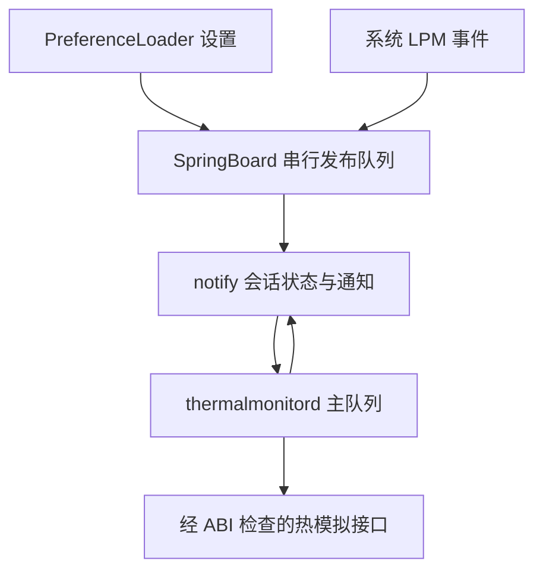

# Powercuff v1.3.6 完整源码复审与 v1.3.7 修订审计

日期：2026-10-30（Asia/Shanghai）。重点目标：iPhone 14 Pro Max / iPhone15,3 / iOS 16.5（20F66）/ RootHide Dopamine 3.0.4。用户偏好为低功耗、稳定性优先，不通过固定频率或更重档位替代验证。

## 1. 基线、范围和证据层级

本次直接获取已发布 v1.3.6 标签的 Git 对象，以提交 `9ef8ebb01551910353c911d1bba10383aa46176e` 建立独立分支。基线共 63 个跟踪文件；公开 DEB 为 17802 字节，SHA256 `ed5ec0c3d7b51c7c7c5b297ca7f0cd6d9f02944e104fb1d275e31b6c87e7636f`。源码标签、此前成功构建及交付包一致。

覆盖所有当前生产源码（Powercuff.x、PCRCore/Preferences/Protocol/Runtime.h）、完整设置 plist、注入过滤、Makefile/control、全部打包/签名验证/规范化脚本、维护脚本、当前只读诊断、回归测试和 workflow。图标检查二进制哈希/包一致性；旧审计文档、1.3.4 专用诊断和根目录历史 DEB 分别按历史资料检查，不把旧二进制当作本轮可重编译源码或交付包。

本轮新增 AUDIT/BUILD/RELEASE-1.3.7.md、发布验证器及其测试、当前诊断测试。最终全部跟踪文件由 SOURCE_FILES.sha256 列出。实际成功提交由 SOURCE_COMMIT、运行 head_sha 与 Release 标签给出；不将本地 Git 历史或计划当作云端成功证据。

源码推理、可复现故障、host 自动化、真实 DEB 检查、目标真机验收是不同层级。以下修复在相应层级验证；没有连接目标真机，不能据此认定历史 SIGBUS/watchdog 已消除或实际续航已提高。

## 2. 发现、影响和处理

| 编号 | 等级 | v1.3.6 问题/风险 | 证据 | v1.3.7 处理 |
|---|---|---|---|---|
| R1 | 高 | 设置/LPM 第一次 post 成功但未送达后，同档去重使 150/600ms 重读不再重发，旧热档位可能持续 | macOS 实际生产核心回归失败，详见下一节 | 三个时间点都重新读取并强制发布，daemon 继续去重私有调用 |
| R2 | 中 | 包白名单只收集普通文件，白名单外空目录仍通过 | 基线真实 DEB 的 control/data 各加入一个 0755 空目录，原验证器均接受 | 验证控制目录仅根目录、数据目录仅预期文件的父目录；两个实际包反例加入构建门禁 |
| R3 | 中 | 公开创建 Release 后上传附件，上传中断可能暴露不完整发布 | workflow 与 gh release create 调用顺序静态证据；未把假想失败当作实际事故 | 草稿上传→完整资产集合/大小/digest/提交验证→公开→公开状态复核 |
| R4 | 中 | 当前只读诊断以 root 运行仅警告仍继续读取错误用户域，未明确阻断身份获取失败 | verify-on-device.sh 控制流 | 仅 uid 501 继续，其他身份/读取失败在采集前退出 2；测试隔离所有外部命令 |
| R5 | 低 | “正常”标题容易与 Off 混淆，LPM 开关未说明保留已选档位 | 设置 plist 与参数映射 | 标称明确标记仍在模拟，补充门控说明与完整参数表 |

没有将系统私有 API、同机其他热控插件、notify 服务完全不可用等无法由源码证明的风险标记为已消除。继续公测，保留最小注入范围、默认 Off 和现有熔断。

## 3. R1 的失败复现与精确修复

[基线运行 41033074996](https://github.com/allantopwisdom-cell/Repo/actions/runs/41033074996)，提交 `5581a741754ee6e58e8af246efa0317e52ea1f5c` 仅修改 tests/test_core.m，生产核心仍为已发布 1.3.6。macOS 15/Xcode 16.4 上 38 项 Python、Foundation 参数/runtime 与此前核心场景通过；随后 test_core.m:308 的 `product.calls == 2 && mode == off && status == 0` 断言失败，退出 134。Theos 构建和发布均未执行。

故障序列：先正常应用 Moderate，虚拟时间推进到启动重发窗口结束以后（120s），请求改为 Off；第一次 post 返回成功但模拟不交付；100ms 后传输恢复。1.3.6 已把 Off 写入“已发布缓存”，后续两次 PCRPublish(NO) 因档位/会话相同直接返回，没有新的通知，product 仍为 Moderate。

这是传输成功返回与接收确认之间的差异；[Apple Libnotify 头文件](https://github.com/apple-oss-distributions/Libnotify/blob/main/notify.h) 也说明通知可合并，post 不能作为对方处理完成的证据。本测试主动模拟丢失以验证容错能力，并不声称在本机已观测到某种特定 notify 故障。

修复只修改生产 PCRRefreshPreferences：立即、150、600ms 使用 PCRPublish(YES)，每次重新读取当前持久域和 LPM。保留 refresh generation 取消旧延迟任务；保留 publish generation 取消旧失败重试；保留 daemon 的 LastApplied 去重。因此健康通信下每个未被新事件取代的变更最多 3 次发布，同档位不重复调用私有 API。发生读/写/发送失败时，各自已有有限重试仍适用。没有增加常驻轮询或自动反复重启。

新增五组核心回归：启动后首次设置丢失仍恢复 Off；LPM 进入和退出首次交付丢失恢复；Heavy→新 Off 取消旧重发并有限结束；偏好延迟到最后一次窗口可见时重读；重发不能绕过异常熔断。保留失败断言和 Drain 的 1000 步上限，不能通过跳过用例或放宽上限通过门禁。

## 4. 框架与线程架构

| 层 | 实际职责 | 检查结论与边界 |
|---|---|---|
| Powercuff.x | 进程/系统门控、注册通知、安装 CommonProduct/GPProduct init hook、LPM 监听 | 仅两进程；iOS major=16；继承 initializer 不重复安装；不能证明私有对象线程亲和性 |
| PCRCore.h 发布端 | 指定偏好域快照、会话请求解码、当前有效档位发布、有限重试/重发 | 全部缓存使用同一串行队列，异步任务按 generation 失效；daemon 不读取用户偏好 |
| PCRCore.h 应用端 | 弱对象捕获、新会话、有效回复校验、私有调用去重、熔断/超时诊断 | 使用主队列，捕获不延长对象生命；新对象使旧异步任务失效；主队列为当前策略而非真机证明 |
| PCRPreferences.h | 从指定 persistentDomainForName 读取一份快照，纯参数解析 | 不用 objectForKey 跨域回退；不会 root 写入默认值 |
| PCRProtocol.h | v2 64 位格式、非零会话、模式/请求标记验证 | 拒绝旧裸档位、旧会话、头部/保留位损坏；非加密认证，不能防御有权改共享状态的其他本机进程 |
| PCRRuntime.h | 返回值/参数数目/对象编码及 hook 归属检查 | 拒绝 block、标量、错参数/返回类型；同 IMP 不等于继承；检查 ABI 不验证参数语义/PAC 实际执行 |
| DEB/维护脚本 | 精确依赖、RootHide 布局、configure/remove 尝试重启 | 成功退出不等于重载确认；不写偏好、不自动注销、不 SIGKILL |
| CI/发布 | host 测试、完整编译、实际包门禁、来源清单、草稿发布 | 精确提交与资产对照；不是目标 iPhone 的执行测试 |

对象的 deferred capture 使用弱引用；对象在队列执行前消失会被忽略；同对象重复捕获不会重建会话。新对象重置 LastApplied 与每对象熔断。CommonProduct 与 GPProduct hook 的安装条件、继承和别名分支有 runtime 回归。生产代码没有替换基础 NSString 比较方法或注入所有 App。

## 5. 功能与每个用户参数

| PowerMode 原值 | 标题 | 实际参数 | 请求语义 |
|---|---|---|---|
| 0，默认 | 关闭 | off | 请求退出模拟，系统真实热保护保留 |
| 1 | 标称（仍在模拟） | nominal | 仍主动请求标称模拟，不能视为恢复系统自动策略 |
| 2 | 轻度 | light | 请求轻度热模拟，用于首次功能验收 |
| 3 | 中度 | moderate | 请求中度热模拟，性能/帧率/续航须实测 |
| 4 | 重度 | heavy | 请求重度热模拟，未作为本机默认或推荐常驻档位 |

模式字符串与上游 Powercuff.x 映射核对。本版不引入上游的 nil→off 双调用；未知私有语义下增加调用没有目标设备证据。Off 方法返回不证明其他插件未继续施加策略。

| 门控 RequireLowPowerMode | 系统 LPM | 有效请求 | 保存值 |
|---|---|---|---|
| 缺省/false/0 | 关或开 | 保存的合法 PowerMode | 不变 |
| true/1 | 关 | 0 / off | 不变 |
| true/1 | 开 | 保存的合法 PowerMode | 不变 |
| 非 0/1、字符串、容器、NaN 等非法值 | 任意 | 0 / off | 不自动改写 |

PowerMode 必须为整数 NSNumber 的 0..4；布尔 NSNumber、字符串、非整数、负数、超界、无穷/NaN 等回退 0。数值 double 2.0 可作为整数 2；不会把 2.5 截断为 2。缺少 PowerMode 会有限重读后按 0 发布。缺少门控表示不限制；显式非法门控保守回退 Off。快照保持两个键一致，读取期间改变持久域不会改变已取得的快照。

本轮将 Foundation 回归扩展到全部 5 档 × 门控缺省/布尔/数值 × LPM，加入 BOOL 原值、负无穷和最大无符号整数等边界。没有为用户添加不可证实的频率、温度、帧率或“智能省电”参数。当前只有 PreferenceLoader 设置入口，没有独立控制中心模块。

## 6. 固定时序参数与状态机

| 参数 | 取值 | 作用与上界 |
|---|---|---|
| 协议前缀 | 0x504302（高 24 位） | v2；中间 32 位为会话，低字节为模式或请求 0xA5 |
| 会话 | 随机非零 uint32 | 新 product 更新，拒绝旧会话回复；不作身份认证 |
| 模式 | 0..4 | 超界不允许进入数组/私有调用 |
| 单轮重试 | 初次 + 5 次，400ms 间隔 | 发布、读取、请求各自有 generation；新事件/回复按职责取消旧任务 |
| 请求超时状态 | 最后请求后再等 400ms | 初次健康启动无回复约 2.4s 后状态 11，停止周期请求 |
| 启动补发 | 立即、3/10/30/60s | 读当前值，计划在 60s 结束；单次失败可继续其有限重试 |
| 设置/LPM 补发 | 立即、150/600ms | 健康情况下窗口到最后一次结束；新 refresh 取消旧补发 |
| API 熔断 | 98/99 | 当前对象的 ObjC 异常/ABI 不匹配；新设置不能越过 |

读取耗尽后最多追加一轮 fresh request；恢复锁存不能因自己的无效回复/超时再次解开。明确设置事件可独立发起一轮有限请求；新对象、当前会话有效回复按既有规则恢复。有效同档回复可恢复诊断值，但不会再次执行同档 API。

状态写入成功、post 失败时先使发布缓存失效；快速切回 Off 仍纠正共享 word，旧失败重试不会覆盖新 generation。不同 product、会话或 preference generation 都有已有回归。有限重发不承诺永久故障时自动恢复：事件未到发布端、整个时间窗口丢失、偏好可见性晚于最后重读等仍需诊断/人工注销；不会在不确定时猜测档位并反复调用私有 API。

## 7. 打包、签名与发布链

精确包 ID、iphoneos-arm64e、版本 1.3.7；firmware>=16.0 且<17.0。保留 mobilesubstrate>=0.9.9000 和 preferenceloader 依赖以及已知 Powercuff 变种冲突。只安装一个薄 versioned arm64e PAC00 dylib（subtype 0x80000002）、双进程过滤 plist、设置和三个图标；无新 daemon、LaunchDaemon、entitlement 或网络请求。

verify_package 检查 ar 成员顺序/压缩类型、数值属主/权限、路径规范/重复/链接特殊文件、精确文件及目录白名单、控制元数据/维护脚本/静态资源源码对照、iOS16.0部署目标、RootHide install ID、准确依赖集合。新增目录规则只接受预期文件的必要父目录，防止原验证器忽略未审查的空目录。

CodeDirectory 检查版本布局、代码页/requirements 特殊槽覆盖与哈希、标识符范围、扩展字段以及重叠/重复/未知签名槽；真实 Mach-O 的代码篡改、签名 magic/截断、requirements 改动、零页覆盖及不支持布局必须拒绝。实际 DEB 的脚本/图标/依赖/权限/legacy ABI/成员顺序/压缩错配及两个新增空目录反例必须拒绝。完整性通过不等于证书信任或 iPhone PAC/注入运行通过。

RootHide Theos 与 SDK 沿用固定提交，macOS15/Xcode16.4；不因审计擅自升级工具链。归档 UID/GID 规范为0/0，时间取源码提交；不会修改已签名 payload。所有附件哈希覆盖包括审计、测试输出、环境、源码和验证器，SHA256SUMS 自身再通过资产 digest 核对。

新的 verify_release.py 需要完整且无重复的 manifest，精确的 VERSION/SOURCE_COMMIT 与 tag、草稿/公测类型、资产集合、uploaded 状态、大小和 SHA256。五组测试分别拒绝缺失/多余/重复/未完成资产、错误来源/公开状态/大小/hash、manifest 缺项/重复、构建后本地篡改。草稿完整核对后才执行公开；公开后再次核对。标签以非覆盖方式创建并在公开前后校对提交；已存在的标签/发布会阻断本轮，而不改写历史。

若创建草稿或上传校验失败，流程保留草稿或标签以便排查并返回非零，不能冒充公开交付。该处理不等于任何管理员都无法事后修改 GitHub 资产；来源核对应使用本次运行和本地/公开下载哈希。

## 8. 安装、诊断与历史资料

configure 仅一次 kickstart，失败最多一次 TERM；remove 后尝试重启清除 daemon hook；其他维护动作不改偏好/不重复重启。保留 stdout/stderr 与退出码诊断，命令接受不等于已确认进程加载。本轮保留这些经测试行为。升级/卸载须人工注销 SpringBoard；同协议版本仍需替换实际代码。

verify-on-device.sh 现要求 mobile uid501；root/其他身份/未知身份在任何采集前退出2；help/非法参数不触发采集。报告安装版本和架构，读取请求/发布/applied 快照，提示通知残留和状态11并非 Off。四组隔离测试检查命令均为读取，不连接真机或发重启信号。

旧 1.3.4 专用采集器绑定旧包哈希，不能用来给 1.3.7 放行；相应测试继续只验证历史工具。根目录 14 个 1.1.x/1.2.x 二进制为历史记录，当前发布只从 packages 中精确一个新 DEB 生成。旧 AUDIT/BUILD/LOCAL 文档保留历史身份，当前 README/参数/control/Release 文档使用1.3.7，避免误把旧本地1.3.6当新包。

## 9. 自动化验证清单与限制

本轮 check.sh 的 Python 测试为49项（原38 + 目录2 + 当前诊断4 + 发布5）。macOS 对实际 PCRCore.h 执行20组核心场景（原15 + 新增5），另执行 Foundation 参数/快照和 runtime ABI；C协议、shell/plist与实际DEB检查保留。各项是否真正通过以当前成功运行随附 SOURCE_TESTS.txt 和 verification.txt 为准，不能用本报告替代失败日志。

| 范围 | 验证方法 | 可以证明 | 不能证明 |
|---|---|---|---|
| 参数/快照 | macOS Foundation 执行 | 输入边界、域隔离、LPM 真值表 | iOS cfprefsd 延迟的实际分布 |
| 核心通信/时序 | 生产核心 + 模拟 notify/虚拟时钟 | 指定故障恢复、有限重试/取消、去重/熔断 | 真实 notify 服务全部故障模式 |
| runtime | 真实 ObjC 合成类执行 | 编码/继承/别名判断 | 目标 thermalmonitord 类的具体实现语义 |
| 包/签名 | 实际构建 DEB 字节和反例 | 结构/ABI/哈希/来源一致 | RootHide 实际加载、证书/PAC执行 |
| 公开交付 | Actions、草稿/公开 API、下载比对 | 发布资产对应成功提交与构建 | 设备长期稳定与省电收益 |

## 10. 目标设备待验收表

| 项目 | 操作/观察 | 放行条件 | 当前证据 |
|---|---|---|---|
| 安装/升级 | 包管理器安装1.3.7，人工注销，查看实际包版本与新进程日志 | 两端加载，无新增 daemon 崩溃 | 待真机 |
| 默认与退出 | 先 Off→Light→Off，记录有效设置和新日志 | 档位请求一致，Off 后不遗留人为模拟；勿仅看缓存 | 待真机 |
| LPM门控 | Light+门控开，LPM关→开→关，等各窗口结束 | Off→Light→Off，保存档位不改写 | 待真机 |
| 启动次序 | 分别重启 SpringBoard/daemon，等待有限补发 | 新会话恢复当前值，旧回复不生效 | 待真机 |
| 失败状态 | 查看11/98/99、真实日志和崩溃报告 | 不反复私有调用/请求，不把11当Off | 待真机 |
| 注入/PAC/watchdog | 正常使用并检查 thermalmonitord checkin、SIGBUS等新报告 | 无新增连续崩溃或 watchdog | 待真机 |
| 温控恢复 | 正常负载后回到Off并观察自然降温与流畅度 | 系统真实热保护继续工作，无异常残留 | 待真机 |
| 卸载 | 卸载并注销，两端代码卸载，记录偏好保留 | 系统服务恢复原生行为 | 待真机 |
| 续航与冲突 | 首先停用Hello CPU等其他热控，在相同亮度/网络/负载下比较 | 有重复可比数据，再决定是否常驻Light/Moderate | 待真机 |

鉴于用户既往 thermalmonitord SIGBUS/watchdog 记录，不能以 host 异常熔断测试替代设备加载验收。不要同时用多个热控插件来验证本版，也不为追求省电直接提高到 Heavy。本轮结论为“已定位并修订可复现源码缺陷及发布门禁问题，云端与真实包证据随发布提供；目标设备仍处于公测验收阶段”。
