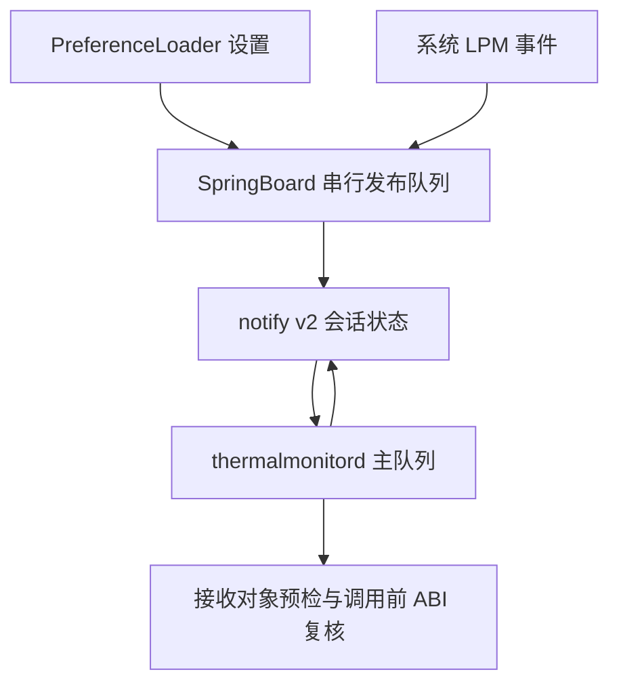

# Powercuff v1.3.7 完整复审与 v1.3.8 修订审计

日期：2026-10-30（Asia/Shanghai）。目标：iPhone 14 Pro Max（iPhone15,3）、iOS16.5（20F66）、RootHide Dopamine3.0.4。优先保持稳定、有限后台活动和参数可解释性，未提高热档位或引入固定频率策略。

## 1. 基线与本轮证据

以已发布 v1.3.7 提交 `bdca4810397010c49696eab57325a825cbc8d778` 为基线，共69个跟踪文件；公开DEB为17982字节，SHA256 `3cf1e41b2a195b0a584534b1f6ad350e0be73e695c0dd5c4415e09993f5b9f35`。新建 release/powercuff-1.3.8，不覆盖旧标签、Release或其他工作区。

用户安装截图给出了真实环境中的 `Please switch to user/foreground/com.apple.thermalmonitord` 警告，随后配置/触发器继续执行。它能支持服务域适配分析，不能证明实际安装字节、插件加载、私有API或温控已通过验收。未连接该设备，不将自动化模拟当作真机证明。

本轮重新审阅全部当前生产源码、通知协议/参数/runtime、设置和注入plist、控制元数据、维护脚本、诊断工具、归档/签名/包/发布验证器及workflow。旧审计、旧1.3.4采集器和14个根目录历史DEB保留为历史资料，不当作本版生产源码或交付。静态图标通过来源哈希与包对照检查。

本版新增三份AUDIT/BUILD/RELEASE文档，全部跟踪文件预计72个。最终以 SOURCE_FILES.sha256 清单、SOURCE_COMMIT、成功运行 head_sha 和新标签的对应关系为准。实际通过记录为 SOURCE_TESTS.txt、verification.txt 和 GitHub job日志。

## 2. 本轮发现及定向修复

| 编号 | 类型 | 发现与影响 | 修订 |
|---|---|---|---|
| R1 | 已观察到的兼容提示 | postinst/postrm 固定使用 system 标识，在用户设备触发 Procursus 自动迁移到前台用户域的警告 | 先只读探测 user/foreground，按需探测 system，只对选中目标 kickstart 一次 |
| R2 | 重载范围与失败处理风险 | 旧脚本在 launchctl 不可用时也按进程名 TERM；失败回退的 killall 不能限定服务域 | 无可确认域/无launchctl则跳过自动重启；仅选中目标 kickstart 失败后，通过 launchctl kill SIGTERM 对同一目标最多一次；不扩大到其他域或按进程名发送 |
| R3 | 可复现的诊断/多余IPC缺口 | 实际接收对象ABI检查放在收到有效档位之后；发布端缺席时，不兼容对象发出请求并最终显示11，掩盖本地ABI问题 | 捕获返回对象后先检查其实际类的方法ABI；不兼容立即熔断99、不启动IPC，并使旧对象请求generation失效 |

R1为真实安装输出的兼容性问题，并非截图证明安装失败。R2属于源码可见的范围风险，不声称用户已遭错误信号。R3通过生产核心的合成接收对象和缺席发布端复现，不声称该设备实际返回了不兼容对象。

## 3. 服务域依据与脚本行为

核对 [Procursus launchctl xpc_helper.c 固定提交](https://github.com/ProcursusTeam/launchctl/blob/22906f7ddaf11ff550da9a2bc5771e3f108fc193/xpc_helper.c)：iOS16及以上的相关路径在 system 查询未成功、前台域查询成功时，输出相同警告并改写请求域；这解释了截图中警告后命令仍返回成功。代码也明确处理不支持 user/foreground 的平台，因此不能无条件把所有调用硬改为前台域。

核对同提交 [kill.c](https://github.com/ProcursusTeam/launchctl/blob/22906f7ddaf11ff550da9a2bc5771e3f108fc193/kill.c)：支持SIG前缀的信号名，并按 service-target 发送。故本版回退使用 `launchctl kill SIGTERM "$target"`，范围保持为已选择的同一服务。两者是源代码依据，不是用户设备上所有命令分支的实测。

| 环境/结果 | 只读探测与操作 | 限制 |
|---|---|---|
| 前台域可查询 | print前台域→kickstart前台域 | 不再因主动使用旧system标识触发该兼容提示；不再额外探测system |
| 前台域不可查询，system可查询 | print前台域→print system→kickstart system | 支持无前台域的环境；不解析不稳定的人类可读输出 |
| 两域均不可查询 | 两次只读print后跳过自动重启 | 不盲目TERM，不把未知域当作已加载；提示越狱应用中人工重启用户空间 |
| launchctl缺席 | 跳过自动重启 | 不自动killall，保留人工处理提示 |
| 选定目标kickstart失败 | 同目标一次定向SIGTERM | 保留两个实际命令诊断和退出码；不再换域或按进程名扩大信号范围 |
| 定向TERM也失败/不支持 | 报告失败并停止 | 不SIGKILL、不重试循环、不自动注销 |

探测输出被抑制以免将预期的不支持域查询当作安装错误；真正的 kickstart/kill 输出不被抑制。探测退出0只用于选择目标，kickstart/TERM返回0只代表请求被接受，均不冒充已确认PID更新、注入成功或热策略生效。configure/remove之外不探测或发信号；脚本不写root/mobile偏好，卸载保留用户设置。脚本保持exit0并明确报告重载失败，避免把已安装文件与实际运行状态混为一谈。

## 4. 基线复现、ABI检查位置与异步取消

[基线运行41037610718](https://github.com/allantopwisdom-cell/Repo/actions/runs/41037610718)，提交 `7ec50127b07ab6eb2d2424910e63f447f04b2380`，仅增加 tests/test_core.m 场景，生产代码仍为1.3.7。macOS15/Xcode16.4上49项Python及此前执行到的核心场景通过；新增“发布端缺席+无方法对象”在test_core.m:284断言失败，退出134。构建和发布未执行。

旧流程的ABI检查在 PCRApplyThermals 获得有效当前会话档位后才发生。无发布端时先发有限6次请求并进入11，无法及时识别本地接收对象缺失方法。构造时对CommonProduct/GPProduct的类检查不足以代替对 initializer 实际返回对象的检查：返回值可能是子类或其他对象。

本版 PCRCaptureProduct 在主队列取得弱引用对象后：更新当前对象，递增 apply/request generation 取消旧任务，重置每对象缓存和熔断，先将等待状态置NO；检查实际类的 `putDeviceInThermalSimulationMode:` ABI，失败立即99并返回；成功才生成非零会话、进入等待10和发请求。PCRApplyThermals 调用前的ABI复核仍保留，Objective-C异常仍98并对该对象熔断。

新增两组执行生产核心的回归：无发布端时不兼容对象立即99且0请求、设置事件不能绕过；错误block参数ABI替换旧对象会取消旧请求和延迟任务，旧对象/错误对象均无私有调用，随后合法对象能新建会话恢复。本轮不删除旧断言或放宽Drain上限，虚拟时钟仍禁止倒退。

服务域测试使用隔离的命令夹具：未修改1.3.7脚本不能满足“先探测前台域并用该域重启”的断言；新脚本的10组用例覆盖前台优先、system回退、无域、缺命令、双域重启失败、定向TERM失败/不支持、成功不回退及生命周期空操作。所有用例对postinst和postrm分别执行，检查每次最多一次kickstart/一次定向TERM，没有defaults写入、全局killall、自动注销或其他命令。

## 5. 完整功能与框架架构复核

| 源码/层 | 完整职责 | 本轮验证与边界 |
|---|---|---|
| Powercuff.x | 仅SpringBoard/thermalmonitord、iOS major16、注册事件、CommonProduct/GPProduct init hook、LPM观察 | ABI/继承/别名检查保留；不注入App/Widget/Settings，无独立控制中心模块 |
| PCRCore.h对象侧 | 弱捕获、同对象去重、新对象取消旧任务、实际对象预检、会话握手、应用去重/熔断 | 预检前移；主队列亲和性和私有对象语义仍须目标设备验证 |
| PCRCore.h发布侧 | 一份偏好快照和当前LPM、有限发布/请求/读取、代际取消和补发 | 保留1.3.7通知丢失修复，不增加持续轮询 |
| PCRPreferences.h | 指定持久偏好域、严格数值解析、LPM门控 | 域隔离、类型/边界与快照测试保留；不读取root域冒充mobile |
| PCRProtocol.h | 高24位v2头、32位非零会话、低字节模式/请求标记 | 旧会话/裸档位/坏头/保留位拒绝；会话是新鲜度协调，不是认证 |
| PCRRuntime.h | 方法返回/参数数目/self/cmd/对象编码、hook所属类判断 | block/标量/错返回拒绝；实际调用前仍检查；不证明PAC执行或私有语义 |
| 设置/注入plist与图标 | 两个设置键、0..4映射、最小注入过滤 | 参数及默认值不变，静态包资源与源码对照 |
| Makefile/control/build.sh | iOS16.5 SDK、16.0部署、arm64e RootHide、完整编译打包与检查 | 工具链固定、依赖/冲突保持、版本升1.3.8；不复用旧dylib |
| 诊断/维护 | mobile只读快照、安装版本和request状态；有限重载动作 | 当前诊断不作活性/温控证明；本轮维护动作按域限定 |
| 验证器/CI | 签名、包结构、来源、反例、草稿后公开 | 保留全部既有门禁，最终附实际测试与包证据 |

普通App不注入；没有基础NSString比较全局hook、修改系统温控阈值、后台冻结或CPU/GPU硬锁。弱引用避免延长旧product生命；deferred capture执行前对象消失会被忽略。两个队列各自管理其角色状态，不把旧的档位值捕获在延迟任务中。

## 6. 每个用户参数及默认/异常值

| PowerMode | 标题 | 私有接口参数 | 行为 |
|---|---|---|---|
| 0，默认 | 关闭 | off | 请求退出模拟；系统真实过热保护仍保留 |
| 1 | 标称（仍在模拟） | nominal | 仍请求标称模拟，不能当作Off |
| 2 | 轻度 | light | 首次功能验收用此档位 |
| 3 | 中度 | moderate | 实际性能/帧率/温控/续航影响须测量 |
| 4 | 重度 | heavy | 未作为本机推荐常驻档位，不为省电自动提升到此档 |

PowerMode只接受0..4的整数NSNumber。布尔、字符串、容器、负数、越界、分数、NaN/正负无穷等回退Off；2.0可表示整数2，2.5不截断为2。缺少档位会有限重读后按Off处理。RequireLowPowerMode缺省/false/0时不限制；true/1时系统LPM关闭→有效Off、开启→保存档位；异常非0/1数值或其他类型→Off。门控不改写保存档位。5个模式、布尔/数值门控和LPM真值组合及ULong等边界有Foundation执行测试。

偏好域为com.minis.powercuff-baldaran-trusted；发布端读取 persistentDomainForName 的一份快照，不跨域搜索。默认值只是缺省行为；卸载保留偏好意味着重新安装可恢复旧设置。无自动建议“最省电”或固定1428MHz参数；与Hello CPU等策略可能互相覆盖，包冲突表不能识别全部热控插件。

## 7. 通信时序、失败状态及资源上界

| 固定参数 | 取值/规则 | 含义 |
|---|---|---|
| 单轮重试 | 初次+5次，400ms间隔 | 请求/发布/读取均有限，新generation取消旧任务 |
| 启动重发 | 立即、3/10/30/60s | 每次读当前值；计划最后一次在60s，单次失败仍有自己的有限重试 |
| 设置/LPM补发 | 立即、150/600ms | 每次重读并发布，新refresh取消旧补发；同档私有调用继续去重 |
| 请求等待诊断 | 最后请求后再等400ms | 无有效回复进入11并保持恢复锁存，不由自己的无效回复反复重开 |
| 新接收对象不兼容 | 立即99，0新请求 | 本轮新增前置预检；旧请求已按generation取消 |
| 实际私有调用异常 | 98 | 对当前对象终止尝试；设置事件不能绕过 |

保留写state成功但post失败时的缓存失效处理，快速返回Off仍能纠正共享状态；保留旧会话拒绝、对象替换、迟到回复、有限恢复、发布端缺席、缺少偏好、LPM进出丢失和快速Heavy→Off回归。方法返回0..4诊断不证明系统真实状态；同档缓存不能发现其他热控插件在后台改了系统策略。

永久通知故障、发布端完全未收到变更、偏好可见性超出有限窗口时，无法保证自动恢复。状态11可能仍有旧档位，不代表Off。重发、前置ABI和ObjC异常处理不能捕获SIGBUS/SIGSEGV/watchdog；不将历史设备崩溃宣布为已解决。

## 8. 打包、签名与发布全过程

包ID保持com.minis.powercuff-baldaran-trusted，版本1.3.8，iphoneos-arm64e；firmware>=16.0且<17.0，mobilesubstrate>=0.9.9000和preferenceloader依赖不变。payload仍为一个薄dylib、过滤plist、设置plist和三个图标；维护脚本三份；没有新增daemon、启动项、权限或网络功能。

验证器保留 ar顺序/压缩匹配、路径/文件/父目录白名单、数值属主0/0、权限、重复/链接/特殊文件拒绝、普通文件尾斜杠拒绝；控制元数据、维护脚本和静态资源对照源码。Mach-O要求versioned arm64e PAC00（0x80000002）、iOS设备平台/16.0部署、精确依赖集合和RootHide install ID。CodeDirectory检查版本布局、代码页/requirements特殊槽覆盖和哈希、标识符范围、重复/重叠/未知槽及扩展字段。

实际DEB执行代码/签名/requirements篡改、零页覆盖、布局异常、脚本/图标/依赖修改、错误权限/legacy ABI/成员顺序/压缩类型、额外control/data空目录、普通文件尾斜杠反例。包检查不能证明设备代码签名信任、PAC运行或真实注入；归档规范化不改变已签名payload。

沿用macOS15/Xcode16.4、固定RootHide Theos `cfba89a53a05b4a1b822121158acc3669c20602f`、iOS16.5 SDK `0222fd5413cf4b9af096f37b4621afa2688572f7`，不因修复服务域擅改编译工具链。源码ZIP本机构建需SOURCE_DATE_EPOCH；失败返回非零，不交付失败构建留下的原始包。

仅release/powercuff-1.3.8成功构建后发布。标签非覆盖创建并绑定该成功提交；同一运行产物先上传草稿，核对全部13项附件的集合、大小、digest、完整SHA256SUMS覆盖、版本、SOURCE_COMMIT和公测/草稿标志，再公开并复核。已有tag/Release阻断，不覆盖或改写历史。SHA256SUMS覆盖自身之外12项，自身再与GitHub资产digest核对。

## 9. 验证门禁与真实设备边界

Python测试由49项变为54项（维护脚本5组扩展为10组）；生产核心由20组变为22组，另有Foundation参数/runtime、C协议、shell/plist、实际包和发布反例。测试脚本中的版本夹具同步1.3.8。是否真正通过以本次成功运行随附日志为准，本报告不能替代失败日志。

本轮修改生产核心的对象捕获预检及postinst/postrm重载策略；不改变用户参数、协议头、热模式字符串、通知重试预算、继承hook判据或异常熔断规则。新证据与故障点对应，既有测试继续执行。

| 设备验收项 | 验收内容 | 当前状态 |
|---|---|---|
| 安装/升级 | 日志选择正确域；人工注销；核对安装版本和两端新日志 | 待真机 |
| 重载失败分支 | 无域或无命令有明确人工提示；不额外按进程名发送信号 | 命令夹具通过，待实际环境 |
| 私有对象/PAC | 合法返回对象可加载调用，无新增SIGBUS/连续daemon崩溃 | 待真机 |
| Off→Light→Off | 请求一致且Off后无模拟残留，真实热保护继续工作 | 待真机 |
| LPM进出 | Light+门控，关→开→关得到Off→Light→Off，保存值不变 | host通过范围见日志，待真机 |
| 启动顺序/待机 | SpringBoard和daemon分别重载、待机唤醒后当前会话恢复 | 待真机 |
| watchdog/温控恢复 | 正常负载后回Off，查看新checkin/崩溃记录与自然降温 | 待真机 |
| 卸载 | 按域尝试重载daemon、人工注销卸载publisher、偏好保留 | 待真机 |
| 续航/其他插件 | 先停用Hello CPU等热控，在相同亮度/网络/负载下重复比较 | 待真机 |

因此继续标记Pre-release。建议首次单独从Off→Light→Off验收，不以更重档位或叠加其他热控插件验证省电；对本设备的稳定性和续航只能由目标真机记录放行。
